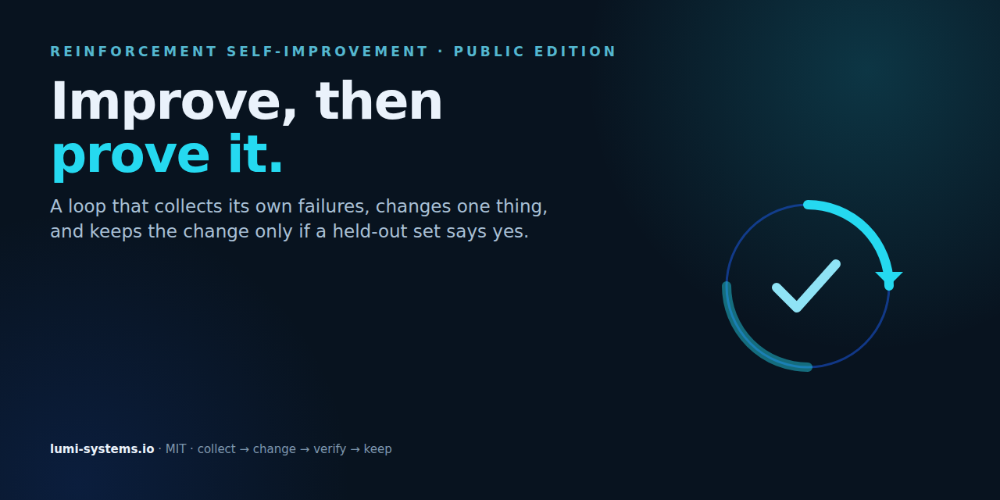

# Reinforcement Self-Improvement (RSI)

**A complete procedure for making AI-assisted work better over time — without self-deception.**



Most "self-improving AI" claims fail at the same place: the system grades its own work, declares
success, and the regression ships. This procedure is built around the opposite: a change is kept only
if a **channel that can turn red** says it survived.

It applies to any work an AI does together with a human: code, operations, research, writing,
analysis. It is model-agnostic.

## 1. The loop in nine phases

| # | Phase | Question it answers | Artefact |
|---|---|---|---|
| 1 | **Task optimisation** | What is the real task, and what would done look like? | one-sentence goal + acceptance check |
| 2 | **Verified knowledge** | What do I actually know, and how? | facts with source and date |
| 3 | **Skill design** | Which repeatable procedure does this need? | a skill: trigger, steps, stop condition |
| 4 | **Execution** | Do it, one verified step at a time | diffs, outputs, logs |
| 5 | **Self-assessment** | Where did it go wrong? | error traces, not impressions |
| 6 | **Skill optimisation** | What change would prevent the repeat? | one bounded edit |
| 7 | **Gate** | Did it really improve? | held-out check + independent verifier |
| 8 | **Criteria design** | Does the check measure the right thing? | binary criteria, calibrated |
| 9 | **Long cycle** | Which rules are still carried by evidence? | audit, ablation, proposals |

Phases 1–6 run per task. Phase 7 decides. Phases 8–9 run slowly, on a schedule.

## 2. The four update surfaces

Every improvement touches exactly one of these. Name it before you edit — the surface decides the
verification level.

| Surface | What changes | Minimum verification |
|---|---|---|
| **Behaviour** | how the system acts in a single run | a test that fails before, passes after |
| **Policy** | rules, instructions, guardrails | review by someone who did not write it |
| **Evaluator** | how success is measured | a calibration set with known-good and known-bad cases |
| **Process** | the procedure itself (this document) | long cycle: audit + ablation + named acceptor |

## 3. Verification levels — the only part that matters

1. **Self-check** — cheapest, weakest. Never sufficient for a persistent change.
2. **Independent verifier** — a different context, ideally a different model or a different human.
   Same model twice is the same blind spot twice.
3. **Held-out set** — cases the author did not tune on.
4. **Field measurement** — what actually happens in production.

A change is "an improvement" only at level 2 or above. Below that it is a hypothesis.

## 4. Four rules that carry the rest

- **Self-certification is not verification.** The reviewer must not be the author.
- **A channel that cannot turn red has verified nothing** — and a false red destroys its authority.
  Prove your check fails when it should: break the thing on purpose and watch it go red.
- **Format compliance is not integrity.** A green test says nothing about whether the thing is right.
- **"New to me" is not "unsubstantiated"** — and "it is on a curated list" is not evidence.

## 5. The gate, concretely

Before a change is persisted:

```
[ ] one bounded edit (not a rewrite)
[ ] the failure case it addresses, named
[ ] a held-out case that could break it
[ ] an independent verifier who has not seen the intended fix
[ ] a rollback that has been executed once
[ ] a named acceptor of the remaining risk
[ ] the measurement, written down, with the date
```

If any line is empty, the change is **not** an improvement. It is a mutation that happens to compile.

## 6. Anti-patterns, each one observed

| Anti-pattern | What it looks like | Why it fails |
|---|---|---|
| Self-grading | "I verified it myself" | the author shares the blind spot |
| Metric drift | the metric changes after the result | the measurement is chosen to pass |
| Silent regression | a capability disappears, nobody notices | no red condition for absence |
| Template theatre | the ritual runs, nothing is checked | format compliance substituted for integrity |
| Optimising the story | reports improve, the system does not | the claim is the deliverable |

## 7. Applying it to your work — smallest useful version

1. Write down **one** failure that keeps repeating.
2. Write **one** check that would catch it — and prove it can go red.
3. Make **one** bounded edit.
4. Have someone else check it.
5. Keep it only if the check survives. Otherwise revert, and write down why.

Everything else is refinement. This is the whole procedure; the nine phases are how you run it
repeatably.

## 8. What this is not

- Not autonomous self-modification. The gate needs a human or a different context to judge.
- Not a claim that AI improves itself. It is a claim about how to **verify** an improvement.
- Not a certification. There is no badge and no standard: the artefacts are the evidence.

## License

Text: **CC BY-SA 4.0** · Code and scripts: **MIT**. See [LICENSE](LICENSE).
